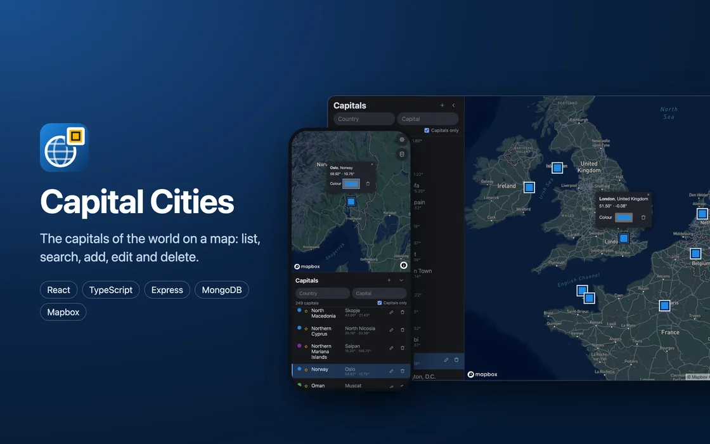

# Example – Capitals #

[](../../actions/workflows/qa-manual.yaml?query=branch%3Amain)
[](../../actions/workflows/qa-auto.yaml?query=branch%3Astaging)

[](https://react.dev)
[](https://www.typescriptlang.org)
[](https://nodejs.org)
[](https://www.mongodb.com)
[](LICENCE)

An API + UI with a MongoDB database, via which one can create, edit, view, and delete capital cities.



## Demonstration ##

See the [demos](demos/README.md), on desktop and on phones.
To capture them again from the running app (needs `just serve-db` and capitals in the DB):

```bash
just demos
```

## Stack ##

- [frontend](frontend): React + TypeScript, Zustand, Mapbox (Vite)

- [backend](backend): Node.js + TypeScript (run natively, no build step), Express, MongoDB driver

- [db](db/schema.js): MongoDB in Docker; the schema runs automatically on the first start

- [models](models/api.yaml): OpenAPI description of the endpoints; TypeScript types are generated from it via `@hey-api/openapi-ts` into `backend/@api` and `frontend/@api` (`just models`)

## Requirements ##

- Node.js ≥ 22.18 and npm (the backend runs TypeScript natively, which needs type stripping without flags, i.e. Node.js 22.18 or newer)

- Docker (for the database)

- [just](https://github.com/casey/just) as task runner

- a [REST Countries](https://restcountries.com) API key and a [Mapbox](https://account.mapbox.com) public token

## Usage ##

```bash
just setup      # creates .env from templates/template.env (fill in the values), installs dependencies
just serve-db   # starts MongoDB on localhost:${DATABASE_PORT}
just dev        # UI on http://localhost:5173, API on http://localhost:${PORT} (GET /health -> {"ok": true})
```

`PORT` and `DATABASE_PORT` are the values from `.env` (3001 and 27017 in [the template](templates/template.env)).

Data, while `just dev` runs (as in the settings panel of the map):

```bash
just data-clear      # removes all cities
just data-examples   # adds the example cities
just data-capitals   # imports all capitals from REST Countries (costs requests of the monthly quota)
just data-cities     # adds a large sample of ordinary cities
just clear-db        # recreates the database itself (needed when db/schema.js changes)
```

When done:

```bash
just stop-db     # stops MongoDB (data is kept)
just clean       # removes build artefacts and generated types
just clean-all   # also removes dependencies, playwright browsers and the docker container, network and volume
```

Run `just` for all recipes.

No just on the host? Run `npm run setup:devcontainer` (needs only Node and npm), then open the repo in a dev container (needs Docker; MongoDB included). The container installs just and generates the types, so all recipes above work in its terminal. Outside it, the `npm run` scripts need just as well, as they only delegate to the justfile. The dev container config is copied from [templates](templates), so for a GitHub Codespace (nothing needed on the host) commit the generated `.devcontainer` folder to a fork first.

## API ##

The API listens on `http://localhost:${PORT}` (3001 in [the template](templates/template.env)).
While `just dev` runs, the same endpoints are also reachable via the UI's dev server under `http://localhost:5173/api`.
All endpoints and their payloads are described in [models/api.yaml](models/api.yaml).

| Method | Path | Body | Responses |
| :----- | :--- | :--- | :-------- |
| `GET` | `/health` | – | `200` `{"ok": true}`, `503` `{"ok": false}` if the database does not answer |
| `GET` | `/capital` | – | `200` all capitals, sorted by country |
| `GET` | `/capital/{key}` | – | `200` the capital with this id or name, `404` if there is none |
| `POST` | `/capital` | capital | `201` the created capital, `400`, `409` |
| `PUT` | `/capital/{id}` | capital | `200` the updated capital, `400`, `404`, `409` |
| `DELETE` | `/capital/{id}` | – | `204`, `404` |

`/city` offers the same operations for all cities (capitals and others); `/capital` only lists capitals and rejects other cities with `400`.

A capital is sent as

```json
{
  "name": "Tokyo",
  "country": "Japan",
  "latitude": 35.68,
  "longitude": 139.69
}
```

and returned with its `id` (which `PUT` and `DELETE` expect), whether it is a capital, and the colour of its marker once one is set:

```json
{
  "id": "4wscVcG-GGEdmTr-BjlOlkL8",
  "name": "Tokyo",
  "country": "Japan",
  "latitude": 35.68,
  "longitude": 139.69,
  "capital": true,
  "colour": "#d32f2f"
}
```

Rules:

- `name` and `country` are non-empty strings, `latitude` lies in [-90, 90] and `longitude` in [-180, 180], otherwise `400`.

- `capital` is optional and defaults to `true`; `colour` is optional (`#rrggbb`).

- A country has at most one capital, and a name is unique within its country, both ignoring case: a second capital of `JAPAN` or a second `tokyo` in Japan gives `409`.

- `GET /capital/{key}` ignores case, too; URL-encode names with spaces (e.g. `/capital/Buenos%20Aires`).

- The `id` is derived from country and name (UUIDv5 as 22 base62 characters) when a capital is created, and kept from then on, even if `PUT` renames it.

- `PUT` replaces all fields, so it needs the full capital.

- An unknown or malformed `id` gives `404`.

- Errors come back as `{"error": "<message>"}`.

Examples (with `PORT=3001`):

```bash
# create
curl -s -X POST localhost:3001/capital \
    -H "Content-Type: application/json" \
    -d '{"name": "Tokyo", "country": "Japan", "latitude": 35.68, "longitude": 139.69}'

# read
curl -s localhost:3001/capital
curl -s localhost:3001/capital/tokyo

# update (id from the responses above)
curl -s -X PUT localhost:3001/capital/<id> \
    -H "Content-Type: application/json" \
    -d '{"name": "Tokyo", "country": "Japan", "latitude": 35.69, "longitude": 139.69}'

# delete
curl -s -X DELETE localhost:3001/capital/<id>
```

## Data ##

On startup, the backend only adds the example cities, and only to an empty database. All countries and their capitals are imported from [REST Countries](https://restcountries.com) v5 (`country` = common name, `name` = first capital) on request: via the data panel of the map or `just data-capitals` (each import costs requests of the monthly quota). `RESTCOUNTRIES_POPULATION_MIN` and `RESTCOUNTRIES_TOP` narrow the selection by population.

The data panel on the map (and the endpoints below) clears and fills the database, for tests and demos. Set `DATA_ACTIONS=false` where data must be kept.

| Method | Path | Does |
| :----- | :--- | :--- |
| `DELETE` | `/data` | removes all cities |
| `POST` | `/data/capitals` | imports the capitals from REST Countries (costs requests of the quota) |
| `POST` | `/data/examples` | adds a few example cities |
| `POST` | `/data/cities` | adds 300 ordinary cities (Natural Earth, public domain) |

## Tests ##

Run everything at once with `just tests` (start the database first with `just serve-db`), or each kind on its own as below.

### Unit tests ###

Test single functions and the store, without database or browser.
They live in [backend/tests](backend/tests) and [frontend/tests](frontend/tests).

```bash
just tests-unit
```

### Behavioural tests ###

Describe the API's behaviour in plain sentences (Gherkin), in [tests/behave/features](tests/behave/features).
They run the API in-process, without database.

```bash
just tests-behave
```

### End-to-end tests ###

Open the UI in a browser against the real API and database, in [tests/e2e](tests/e2e).
The API and UI are started automatically; the first run downloads a browser (Chromium). They only create made-up capitals and remove them again, so the data of `just dev` is kept.

```bash
just serve-db
just tests-e2e
```

### Integration tests ###

Test the API against the real database, in [tests/integration](tests/integration).

```bash
just serve-db
just tests-integration
```

### Explorative tests ###

Start the app and try things out by hand:

```bash
just serve-db
just dev
```

Then open the UI at <http://localhost:5173>, or call the API (3001 is just the example value of `PORT` in `.env`):

```bash
curl -s localhost:3001/health
curl -s localhost:3001/capital
```

See [API](#api) for all endpoints and examples.

## Linting ##

```bash
just prettify     # formats and fixes what it can
just lint-check   # only reports; also type-checks
```

The same checks and tests run on GitHub via [qa-auto](.github/workflows/qa-auto.yaml) (pull requests) and [qa-manual](.github/workflows/qa-manual.yaml) (on demand).
