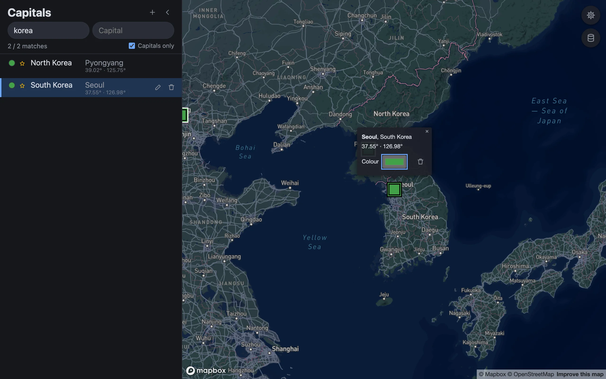
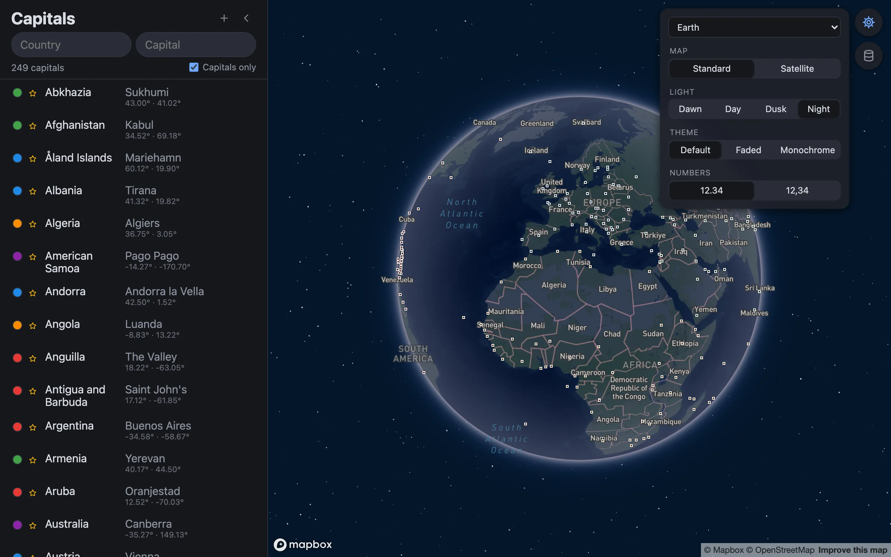
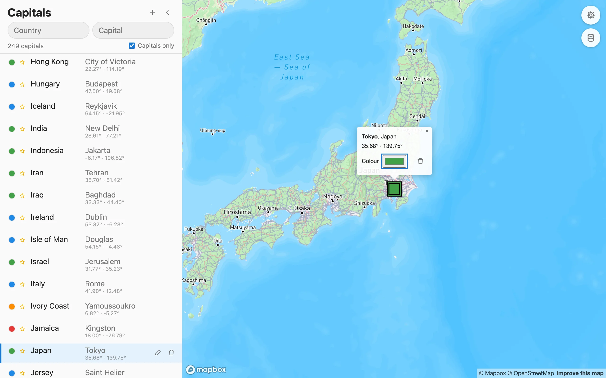
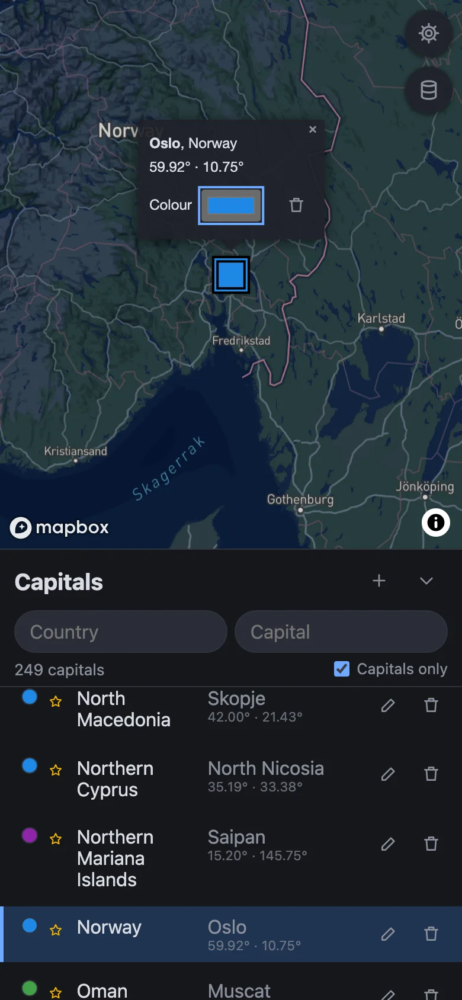
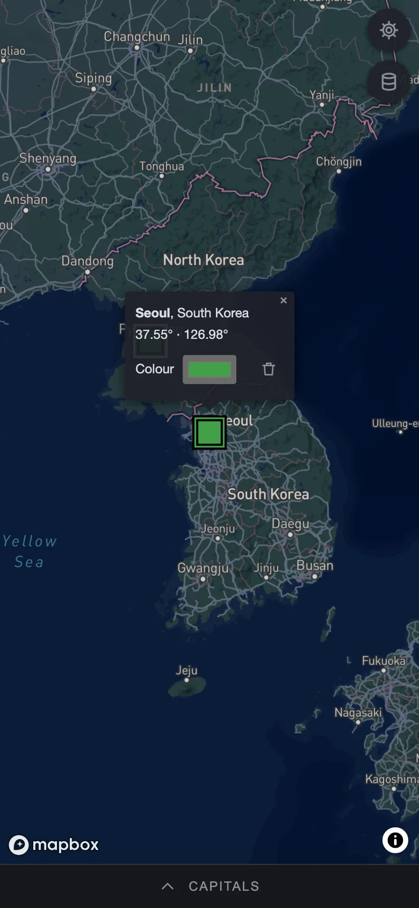

# Demos #

Screenshots of the application, captured from the running app with `just demos` (see [/tests/demos](../tests/demos/demos.spec.ts)). So is the animation at the top of the [README](../README.md) (`img/hero.webp`: the cover first, then the scenes below; joined by ffmpeg, cf. [hero.ts](../tests/demos/hero.ts)).

## Overview ##

The list of capitals next to the map: selecting a capital (in the list or on the map) flies there and opens a popup, in which the colour of its marker can be changed.

## Search ##

Search by country and by capital (both narrow down); only matches are shown, ↑/↓ step through them and Enter selects.

## Add, edit and delete ##

Each entry can be edited in place (name, country, coordinates and the colour of its marker) or deleted; `+` in the header adds a new one.

## Map settings ##

Basemap, light preset, theme and number format.

## Phones ##

On narrow screens the list sits below the map and can be collapsed to a bar.

| Map and list | List collapsed |
| :----------: | :------------: |
|  |  |

## Social preview ##

[img/social-preview.jpg](img/social-preview.jpg) (2560 × 1280, the cover of the hero) is the image for link previews of the repository: upload it on GitHub under Settings → General → Social preview.
